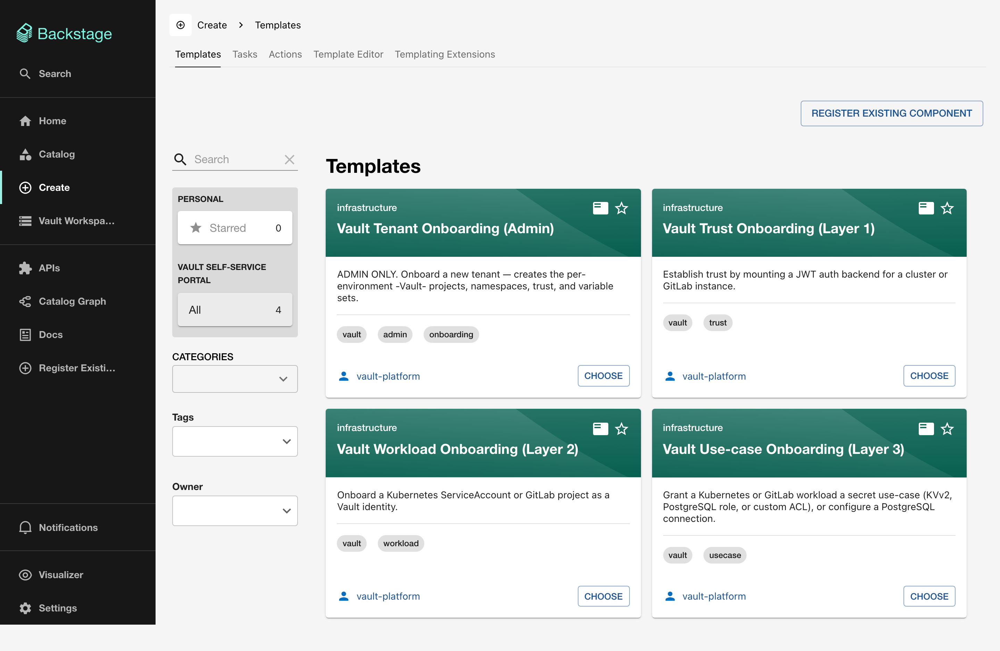

# Template cards

The portal surfaces four template cards on the Backstage **Create** page. Each card is a guided form that provisions Vault infrastructure through HCP Terraform. No Terraform code is required.

## Card overview

| Card | Layer | Audience | Description |
|------|-------|----------|-------------|
| [Vault Tenant Onboarding (Admin)](admin-onboarding.md) | L0 | Platform team | Creates HCP Terraform projects, Vault namespaces, trust, and variable sets for a new tenant |
| [Vault Trust Onboarding](trust-onboarding.md) | L1 | Platform team | Mounts a JWT auth backend for a Kubernetes cluster or GitLab instance |
| [Vault Workload Onboarding](workload-onboarding.md) | L2 | App teams | Registers a Kubernetes ServiceAccount or GitLab project as a Vault identity |
| [Vault Use-case Onboarding](usecase-onboarding.md) | L3 | App teams | Grants KVv2, PostgreSQL role, custom ACL, or PostgreSQL connection access |

## Execution flow

Every card follows the same pattern:

1. User clicks **CHOOSE** on the card
2. Fills in the form fields (1 step per card, with conditional fields based on selections)
3. Clicks **Create**
4. The scaffolder runs the `hcptf:nocode:provision` action
5. An HCP Terraform workspace is created and the no-code module is applied
6. Links to the workspace and run are returned

!!! info "Entity Pickers"
    Cards at L1 and above include **Entity Picker** fields that list only the relevant upstream entities. For example, the Trust card shows only `vault-target` Resources created by the Admin card. If the picker is empty, check three things: the upstream template has run, its HCP Terraform run applied successfully (pickers only list workspaces whose outputs exist), and the catalog has refreshed since, which takes up to 5 minutes.

## If a run fails

The scaffolder creates the HCP Terraform workspace first, then waits up to 20 minutes for the run. If the run errors, is canceled or discarded, or the wait times out, the task fails and the workspace stays in HCP Terraform:

- Open the task log: the error includes the run URL when a run was created, and the workspace is listed in HCP Terraform under the tenant project (the admin project for the Admin card).
- Fix the cause in HCP Terraform and start a new run there, or delete the workspace before you run the card again with the same Workspace Name, which would otherwise collide with it.
- After a timeout, check the run in HCP Terraform before you retry; it may still apply.

## Limitations

- **Create only.** The cards create workspaces; none of them changes or destroys one. Change inputs or destroy in HCP Terraform, and destroy from the top layer down (L3, then L2, L1, L0), because each layer depends on the one below it.
- **Deleting a catalog entity does not delete the workspace.** The provider recreates the entity on its next refresh while the workspace exists.
- **The audience column is a convention.** The reference permission policy does not stop other users from running the Admin card; refer to [Add authentication gates](../integration/templates.md#add-authentication-gates) to restrict it.
