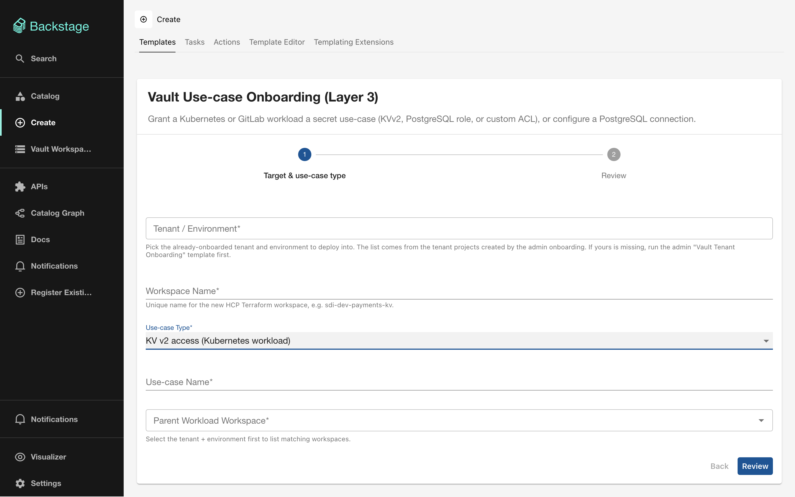
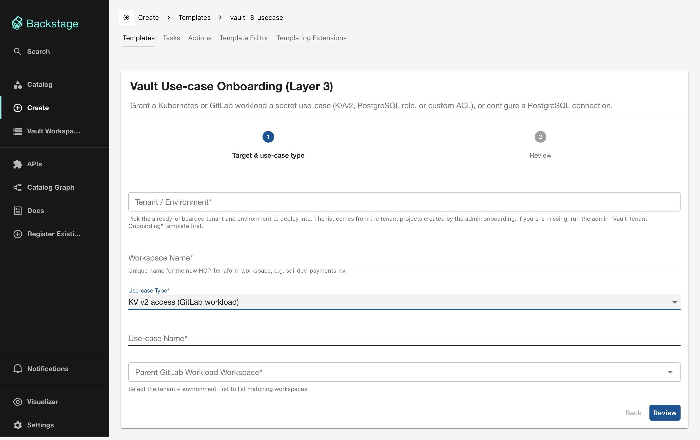
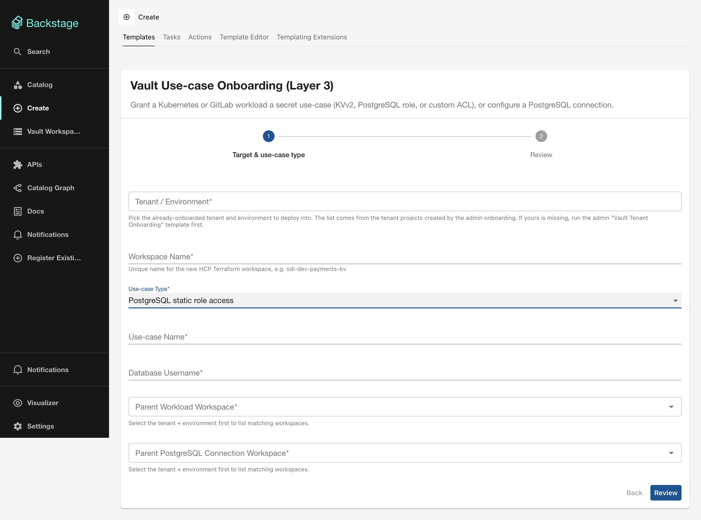
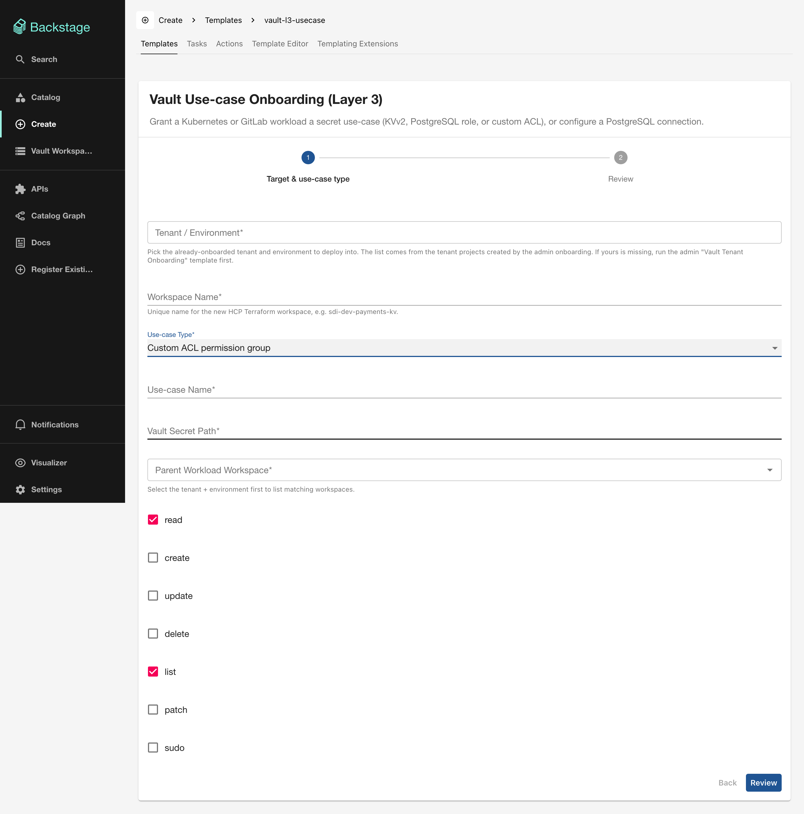
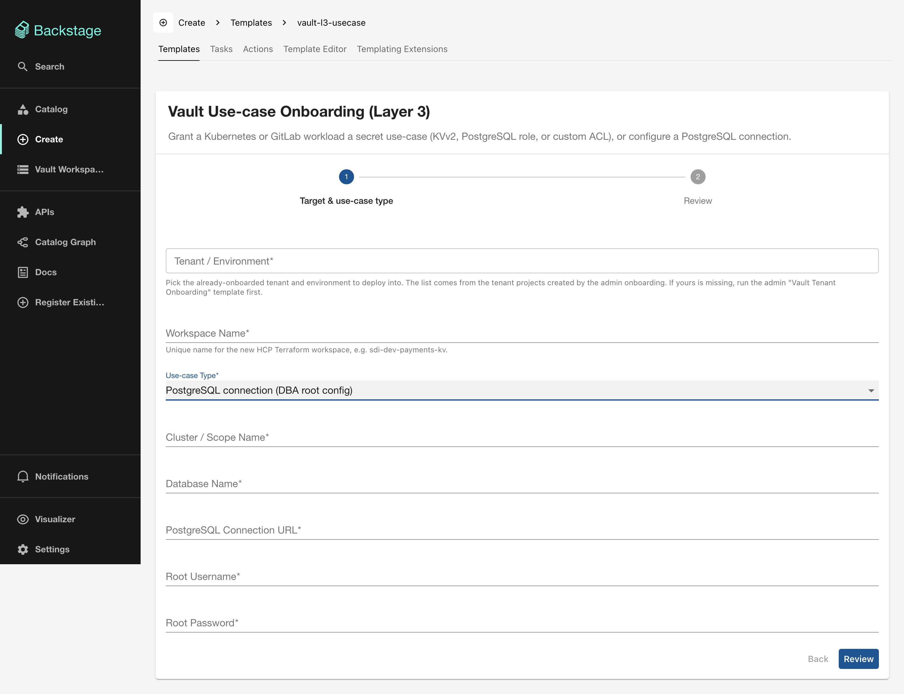

# L3: Vault use-case onboarding

## What it does

Grants an onboarded workload access to a specific type of Vault secret. This is the final layer. It creates the policy, identity group binding, and (where applicable) the secret engine mount.

Five use-case types are supported:

| Use-case | Description | Module |
|----------|-------------|--------|
| **KV v2 (Kubernetes)** | KVv2 mount + read policy for a K8s workload | [`terraform-vault-add-kvv2`](../modules/add-kvv2.md) |
| **KV v2 (GitLab)** | KVv2 mount + read policy for a GitLab workload | [`terraform-vault-add-kvv2`](../modules/add-kvv2.md) |
| **PostgreSQL static role** | Database static role access through Vault DB engine | [`terraform-vault-add-pgsql-role`](../modules/add-pgsql-role.md) |
| **Custom ACL permission group** | Arbitrary Vault path capabilities | [`terraform-vault-add-permission-group`](../modules/add-permission-group.md) |
| **PostgreSQL connection (DBA)** | Root DB engine + connection setup | [`terraform-vault-pgsql-onboarding`](../modules/pgsql-onboarding.md) |

## Form fields

### Common fields

| Field | Required | Type | Description |
|-------|----------|------|-------------|
| **Tenant / Environment** | Yes | Entity Picker | Select the tenant target created by L0. |
| **Workspace Name** | Yes | `string` | Unique HCP Terraform workspace name, such as `sdi-dev-payments-kv`. |
| **Use-case Type** | Yes | `enum` | Selects which use-case to provision (see table above). |

The use-case modules find the Vault identity entity by the name `<cluster>-<workload>`, so every use-case backed by a parent workload takes the cluster (or GitLab instance) name and the workload name from that parent's outputs. There are no form fields for them, which keeps them from drifting out of sync with L1/L2. The parent pickers list only workspaces that have been applied, because an unapplied workspace has no outputs to read.

### KV v2 (Kubernetes workload)

| Field | Required | Type | Description |
|-------|----------|------|-------------|
| **Use-case Name** | Yes | `string` | Identifier for this use-case, such as `app-config`. |
| **Parent Workload Workspace** | Yes | Scoped Entity Picker | The L2 Kubernetes workload workspace. Supplies the cluster and workload names. |

### KV v2 (GitLab workload)

| Field | Required | Type | Description |
|-------|----------|------|-------------|
| **Use-case Name** | Yes | `string` | Identifier for this use-case. |
| **Parent GitLab Workload Workspace** | Yes | Scoped Entity Picker | The L2 GitLab workload workspace. Supplies the GitLab instance and workload names. |

### PostgreSQL static role

| Field | Required | Type | Description |
|-------|----------|------|-------------|
| **Use-case Name** | Yes | `string` | Identifier for this use-case. |
| **Database Username** | Yes | `string` | The PostgreSQL username for the static role. |
| **Parent Workload Workspace** | Yes | Scoped Entity Picker | The L2 Kubernetes workload workspace. Supplies the cluster and workload names; the static role is prefixed with the cluster name, so pick a connection onboarded for the same cluster. |
| **Parent PostgreSQL Connection Workspace** | Yes | Scoped Entity Picker | The L3 PostgreSQL connection workspace that backs this role. |

### Custom ACL permission group

| Field | Required | Type | Description |
|-------|----------|------|-------------|
| **Use-case Name** | Yes | `string` | Identifier for this use-case. |
| **Vault Secret Path** | Yes | `string` | The Vault path to grant capabilities on. |
| **Parent Workload Workspace** | Yes | Scoped Entity Picker | The L2 workload workspace. Supplies the cluster (or GitLab instance) and workload names. |
| **read** | — | `boolean` | Default: `true` |
| **create** | — | `boolean` | Default: `false` |
| **update** | — | `boolean` | Default: `false` |
| **delete** | — | `boolean` | Default: `false` |
| **list** | — | `boolean` | Default: `true` |
| **patch** | — | `boolean` | Default: `false` |
| **sudo** | — | `boolean` | Default: `false` |

### PostgreSQL connection (DBA root config)

| Field | Required | Type | Description |
|-------|----------|------|-------------|
| **Cluster / Scope Name** | Yes | `string` | Scope identifier. |
| **Database Name** | Yes | `string` | Database identifier. |
| **PostgreSQL Connection URL** | Yes | Secret | Connection string for the database. Kept out of the task's parameters and sent to HCP Terraform as a sensitive variable. |
| **Root Username** | Yes | `string` | Database admin username. |
| **Root Password** | Yes | Secret | Database admin password. Kept out of the task's parameters and sent to HCP Terraform as a sensitive variable. |

!!! warning "Sensitive inputs"
    The PostgreSQL connection URL and root password are marked as sensitive variables in HCP Terraform and are never stored in Backstage or the catalog.

## Output

- **HCP Terraform run status**
- **Link to the HCP Terraform Workspace**
- **Link to the HCP Terraform Run**
