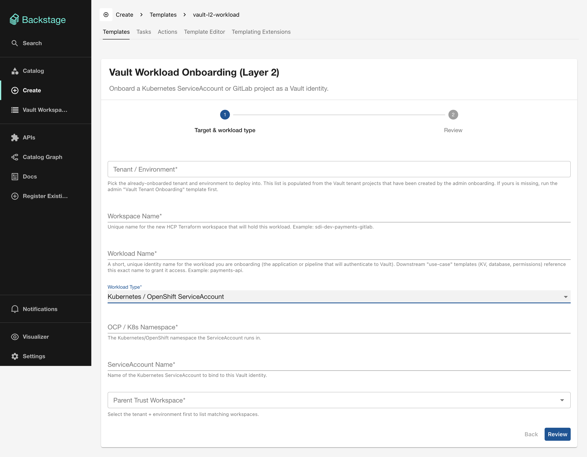

# L2: Vault workload onboarding

## What it does

Registers a workload, either a Kubernetes ServiceAccount or a GitLab project, as a Vault identity entity. This creates the auth role and identity entity that use-case templates (L3) bind policies to.

Two workload types are supported:

- **Kubernetes / OpenShift ServiceAccount**: binds a namespace and service account to a Vault identity
- **GitLab project**: binds a GitLab project ID and path to a Vault identity

## Terraform modules

| Workload type | Module |
|--------------|--------|
| Kubernetes | [`terraform-vault-add-k8s-namespace-access`](../modules/add-k8s-namespace-access.md) |
| GitLab | [`terraform-vault-add-gitlab-project-access`](../modules/add-gitlab-project-access.md) |

## Form fields

### Common fields

| Field | Required | Type | Description |
|-------|----------|------|-------------|
| **Tenant / Environment** | Yes | Entity Picker | Select the tenant target created by L0. |
| **Workspace Name** | Yes | `string` | Unique HCP Terraform workspace name, such as `sdi-dev-payments-gitlab`. |
| **Workload Name** | Yes | `string` | Short identity name for the workload (the app or pipeline authenticating to Vault). Downstream L3 templates reference this name. |
| **Workload Type** | Yes | `enum` | `Kubernetes / OpenShift ServiceAccount` or `GitLab project`. |

### Kubernetes-specific fields

The following fields appear when you set Workload Type to **Kubernetes / OpenShift ServiceAccount**.

| Field | Required | Type | Description |
|-------|----------|------|-------------|
| **OCP / K8s Namespace** | Yes | `string` | The namespace the ServiceAccount runs in. |
| **ServiceAccount Name** | Yes | `string` | Name of the Kubernetes ServiceAccount to bind. |
| **Parent Trust Workspace** | Yes | Scoped Entity Picker | The applied L1 cluster trust workspace. Supplies the cluster name, which scopes the JWT mount and the Vault entity name. Scoped to the selected tenant. |

### GitLab-specific fields

The following fields appear when you set Workload Type to **GitLab project**.

| Field | Required | Type | Description |
|-------|----------|------|-------------|
| **GitLab Project ID** | Yes | `string` | Numeric project ID (Settings > General > Project ID in GitLab). |
| **GitLab Project Path** | Yes | `string` | Full path, such as `platform/payments-api`. |
| **Parent GitLab Trust Workspace** | Yes | Scoped Entity Picker | The applied L1 GitLab trust workspace. Supplies the GitLab instance, which scopes the JWT mount and the Vault entity name. Scoped to the selected tenant. |

## Output

- **HCP Terraform run status**
- **Link to the HCP Terraform Workspace**
- **Link to the HCP Terraform Run**

## What to do next

With the workload registered, grant it access to secrets using [L3: Use-case onboarding](usecase-onboarding.md).
